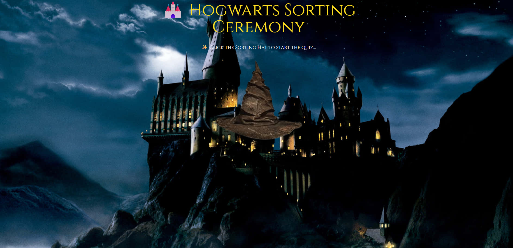
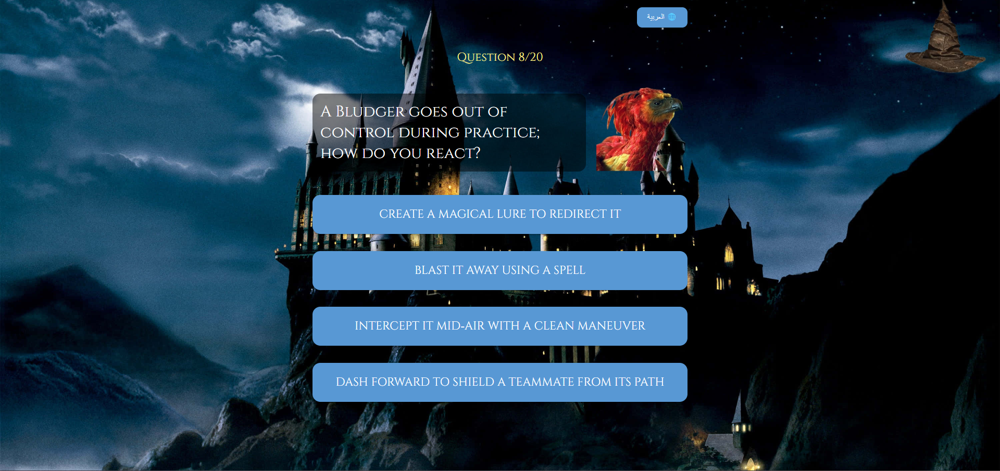
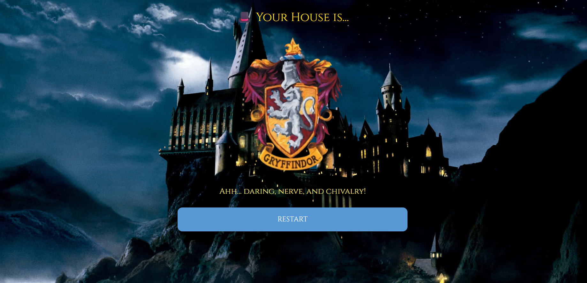

# 🧙‍♂️ Hogwarts Sorting Hat Quiz 

*An interactive, multi-sensory Harry Potter Sorting Hat ceremony powered by Machine Learning and NiceGUI, featuring bilingual support and detailed personality trait breakdowns.*

---

##  About The Project

Welcome to the **Hogwarts Sorting Hat Quiz**! Moving away from traditional static scoring systems, this project implements an advanced **Predictive Personality Engine**. 

The application immerses users in the magical wizarding world through an asynchronous web interface. Players answer a series of behavioral questions, and their choices dynamically map across **8 distinct behavioral dimensions**. 

###  New Features & Enhancements:
- **Bilingual Support (Arabic & English):** Fully translated questions to ensure an accessible and engaging experience for non-English speakers.
- **Detailed Trait Breakdown:** Beyond just picking a house, the system calculates and displays the exact percentage/score of each personality trait.
- **Multi-Sensory UI:** Synchronized audio effects, dynamic house crests, and an atmospheric Hogwarts theme built with **NiceGUI**.

---
##  User Interface Preview

### Home Page

###  Quiz Questions

###  Sorting Result & Trait Breakdown

##  System Architecture & Workflow

1. **Frontend (NiceGUI):** Presents sequential questions across 8 behavioral dimensions. A minimum threshold of **10 answers** is enforced to ensure high data density before prediction.
2. **Trait Scoring Engine:** Accumulates points per choice (e.g., Bravery +1, Intelligence +1).
3. **AI Backend:** Serializes the scores into a NumPy feature vector, which is then processed by a pre-trained **Logistic Regression** model to output Softmax probabilities for each House (Gryffindor, Slytherin, Ravenclaw, Hufflepuff).
4. **UI Output Module:** Displays the final house prediction alongside custom crests, audio cues, and the newly added trait percentage breakdown.

---

##  Machine Learning Pipeline

- **Exploratory Data Analysis (EDA):** Rigorous statistical mapping (ANOVA) revealed strong correlations (e.g., Gryffindor tied to Bravery/Quidditch; Slytherin tied to Ambition/Dark Arts) with a 100% "Zero-Noise" check.
- **Algorithm Selection:** Evaluated against SVM, **Multinomial Logistic Regression** triumphed by providing superior probabilistic outputs.
- **Hyperparameter Optimization:** Utilized Grid Search CV to eliminate overfitting, yielding outstanding metrics:
  - **Training Accuracy:** 100%.
  - **Testing Accuracy:** 99%.
  - **Inference Speed:** < 0.01 seconds per prediction.
- **The Scaling Breakthrough:** Bypassed standard scalers (MinMaxScaler/StandardScaler) to preserve the natural integer magnitude of the 1–10 scores, capturing peak model performance.

---

##  Performance Metrics

| House | Precision | Recall | F1-Score |
| :--- | :---: | :---: | :---: |
| **Gryffindor** | 0.98 | 1.00 | 0.99 |
| **Hufflepuff** | 0.99 | 0.97 | 0.98 |
| **Ravenclaw** | 0.99 | 0.99 | 0.99 |
| **Slytherin** | 1.00 | 1.00 | 1.00 |

---
 ## Future Roadmap
- **Biometric Sentiment Analysis**: Utilizing OpenCV to detect user emotions during the ceremony for dynamic trait scoring.  
